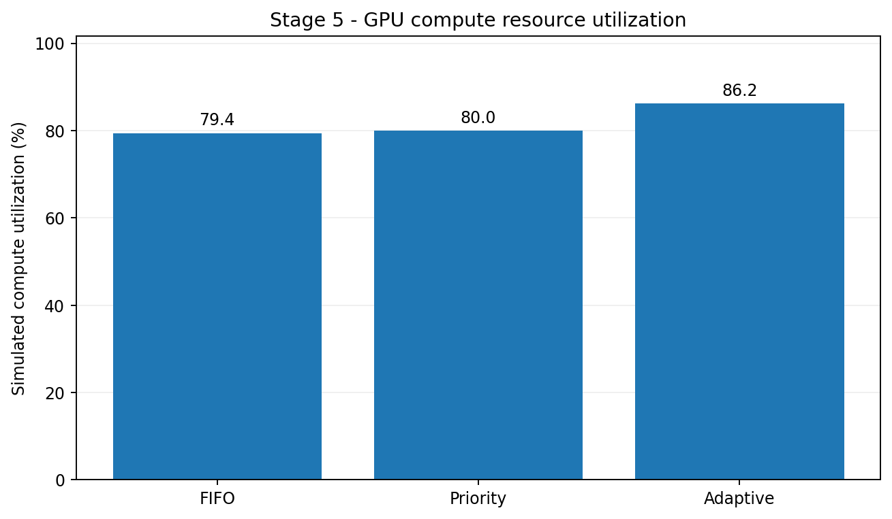
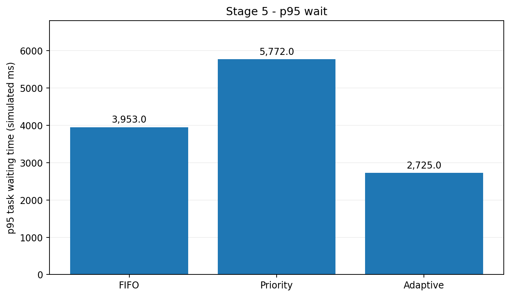
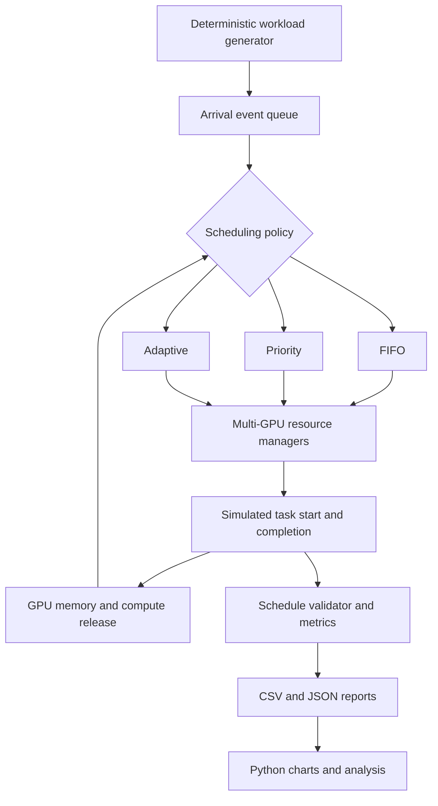
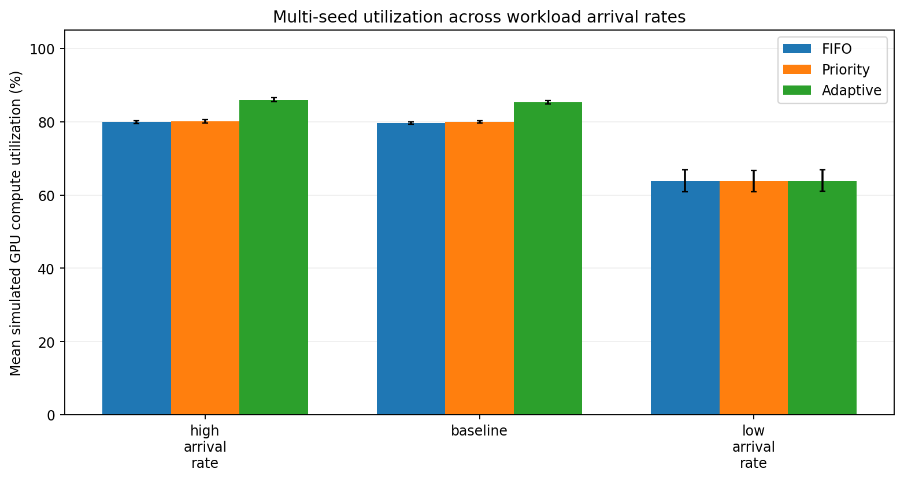
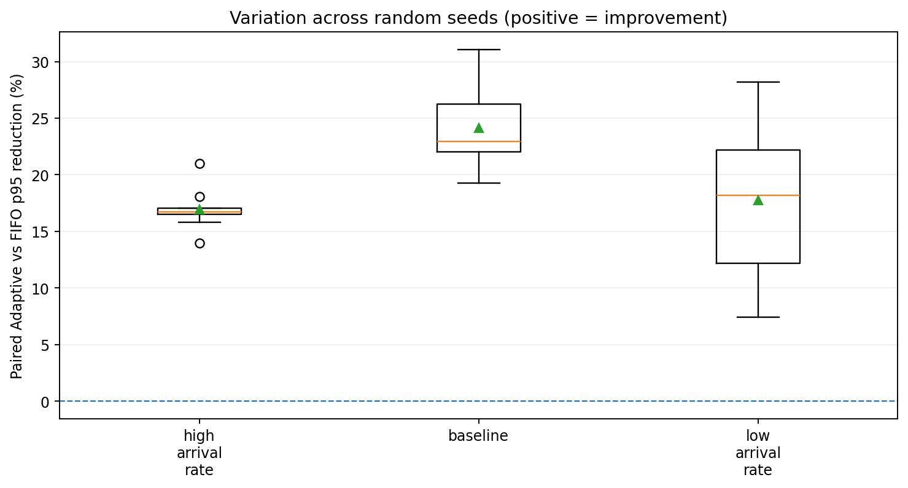

# GPU Workload Scheduling Simulator

**Go · Python · Docker · Discrete-event simulation · Multi-GPU scheduling**

A reproducible **simulation** of GPU workload scheduling for model training, inference, and evaluation. The Go engine models discrete task arrivals/completions, non-preemptive placement across a four-GPU cluster, bounded memory/compute capacity, and three scheduling policies: **FIFO**, **Priority**, and **Adaptive**.

> **Scope:** This is a scheduling simulator, **not** a real GPU cluster or NVIDIA driver integration. All runtimes are *simulated milliseconds*. GPU compute utilization means time-weighted occupancy of *reserved simulated compute units*, not measured hardware GPU utilization.

## Key results

Fixed seed **20261024**, **1,000** generated workloads, **4** simulated GPUs, identical input and resource capacities for all strategies:

| Metric | FIFO | Priority | Adaptive |
|:---|---:|---:|---:|
| Completed tasks | 1,000 / 1,000 | 1,000 / 1,000 | 1,000 / 1,000 |
| Simulated compute-resource utilization | 79.42% | 79.97% | **86.17%** |
| p95 task waiting time | 3,953 ms | 5,772 ms | **2,725 ms** |
| Makespan | 13,065 ms | 12,976 ms | **12,042 ms** |

**Adaptive vs FIFO:** **+6.75 percentage points** compute utilization, **31.07% lower p95 waiting time**, and **7.83% shorter makespan** in this fixed-seed experiment. These are experiment-specific observations—not guaranteed improvements on other distributions or real GPU hardware.




## How it works



The **discrete-event simulator is deterministic and advances a logical clock**; the engine does not run actual training or GPU kernels in parallel. The `ResourceManager` uses `sync.Mutex` to protect allocation/release state and is exercised by concurrent goroutine unit tests.

| Policy | Selection and placement |
|:---|:---|
| **FIFO** | Stable arrival order; strict head-of-line discipline; first-fit by GPU ID |
| **Priority** | Lower numeric priority runs first; ties are stable; non-preemptive; first-fit placement |
| **Adaptive** | Aging every 20 simulated ms; guarded backfilling; workload-sensitive best-fit placement |

Adaptive's backfilling protects the **currently blocked head task's earliest feasible start based on running tasks**. It does not guarantee the same reservation against *future arrivals*. See [architecture and policy notes](docs/ARCHITECTURE.md).

## Reproduce locally

Prerequisites: a compatible Go toolchain (tested with **Go 1.27.3**); **Python 3.12** for the pinned Python dependencies. Commands below are from the repository root.

```powershell
# Go correctness and race detector (Windows -race additionally needs CGO and GCC)
go test ./... -count=1
go test -race ./... -count=1

# Identical input for all three schedulers
go run . -stage 5 -tasks 1000 -seed 20261024 -out stage5_results

# 10 seeds × 3 arrival-rate scenarios × 3 policies = 90 runs
go run . -stage 6 -tasks 1000 -seed 20261024 -seeds 10 -out stage6_results

# Windows: isolate Python 3.12 from other Python installations
py -3.12 -m venv .venv312
.\.venv312\Scripts\python.exe -m pip install --only-binary=:all: -r requirements.txt
.\.venv312\Scripts\python.exe analytics\plot_results.py --stage5 stage5_results --stage6 stage6_results --out stage8_analytics
```

### Docker: run everything in one command

Docker Desktop must be running in Linux-containers mode.

```powershell
docker build -t gpu-scheduling-simulator:stage8 .
New-Item -ItemType Directory -Force stage8_results | Out-Null
$outputDir = (Resolve-Path .\stage8_results).Path
docker run --rm --mount "type=bind,source=$outputDir,target=/results" gpu-scheduling-simulator:stage8
```

Expected output: `stage8_results/stage5_results/`, `stage8_results/stage6_results/`, and `stage8_results/analytics/` (six PNG plots, `REPORT.md`, `metrics.json`).

**Windows race-test note:** if `-race requires cgo`, enable CGO and make an installed MinGW-w64 GCC accessible on PATH. Follow [testing documentation](docs/TESTING.md).

## Robustness across seeds and load scenarios

10 paired seeds, 1,000 tasks per seed and policy; workload-arrival spacing scaled across three scenarios:

| Arrival scenario | Mean FIFO utilization | Mean Adaptive utilization | Mean *paired* p95 reduction |
|:---|---:|---:|---:|
| High arrival rate | 79.88% | 86.00% | 16.93% |
| Baseline | 79.63% | 85.34% | 24.11% |
| Low arrival rate | 63.87% | 63.88% | 17.76% |

At low arrival rates, utilization is essentially unchanged, demonstrating a limitation of the Adaptive strategy's benefits. The paired p95 percentage is calculated *per seed* and then averaged; it is **not** derived by subtracting the displayed mean p95 values.




## Repository map

```text
gpu-workload-scheduling-simulator/
├── main.go                    # CLI: stage 5 / stage 6 experiment entry point
├── model.go                   # Tasks, GPU resources, validation
├── allocator.go               # Mutex-protected GPU resource management
├── cluster.go                 # Deterministic multi-GPU FIFO
├── priority.go                # Non-preemptive strict priority
├── adaptive.go                # Aging, guarded backfilling, best-fit
├── benchmark.go               # 1,000-workload generator, metrics, CSV export
├── robustness.go              # Multi-seed load/stress runs
├── *_test.go                  # Unit, audit, regression tests
├── analytics/plot_results.py  # Python analytics
├── docker/run-all.sh          # Container workflow
├── Dockerfile
├── requirements.txt
├── docs/                      # Architecture, benchmark, tests, reproducibility
└── .github/workflows/ci.yml   # Automated Go and Docker checks
```

The tree is illustrative: additional original Stage 2/3 Go files may also be present.

## Further documentation

- [System design and scheduler behavior](docs/ARCHITECTURE.md)
- [Benchmark methodology and measured results](docs/BENCHMARK.md)
- [Correctness, concurrency, and test scope](docs/TESTING.md)
- [Reproduction and troubleshooting](docs/REPRODUCE.md)
- [Project completion and publishing checklist](docs/PUBLISH_CHECKLIST.md)

## Limitations

1. Tasks, resource budgets, arrival times and durations are synthetic; no GPU jobs are executed.
2. Scheduling is non-preemptive; this is not a production Kubernetes/Slurm scheduler.
3. The event engine itself is deterministic rather than parallel GPU execution; the resource manager is concurrency-safe.
4. The seed=20261024 headline metrics describe **one** experiment. Multi-seed results separately characterize variation for chosen scenarios.
5. Race-detector success covers executed paths; it does not prove an absence of all concurrency issues.

**Built in 2026 as an independent systems-engineering portfolio project.**
