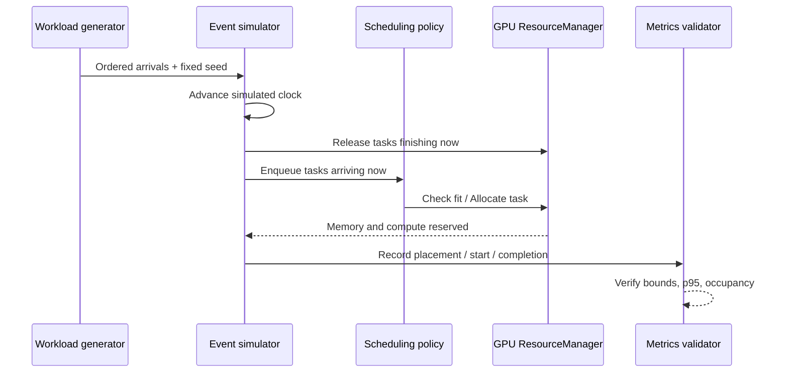

# Architecture and scheduling policies

## Boundaries

**Simulation:** a logical clock advances between workload arrivals and completions. It is deterministic and has no real GPU execution, kernel launch, or GPU telemetry. A workload carries an arrival timestamp, duration, priority, memory demand (MiB), compute demand (abstract units), and type (`training`, `inference`, `evaluation`).

**Resource model:** multiple modeled GPUs, each with independent memory and compute capacities. Allocation/release is guarded by a Go `sync.Mutex`. The event simulator chooses when to call that resource manager. The scheduling event loop itself is not a goroutine-per-task execution engine.

At each event timestamp, completed tasks release resources before newly arriving tasks are scheduled. All workloads are **non-preemptive** once started.

## Algorithms

### FIFO (`cluster.go`)

Waiting jobs are ordered by arrival, preserving source order for simultaneous arrivals. Scheduler attempts the head first; if it cannot fit, jobs behind it do not bypass. First-fit chooses the available GPU with lowest ID. This strict queue discipline creates head-of-line blocking.

### Priority (`priority.go`)

From waiting tasks, the smallest numeric priority value is selected first (`1` is highest). Equal priorities retain stable queue order. Like FIFO, it does not backfill when the selected head cannot fit and uses deterministic first-fit placement. A short high-priority task can overtake a low-priority queued task; starvation risk is possible.

### Adaptive (`adaptive.go`)

- **Aging:** every **20 simulated ms** of waiting improves effective numeric priority by one level, with a floor of `1`.
- **Best fit:** candidate GPUs are scored on normalized post-placement free memory and compute. For **training**, memory has larger weight; **inference**, compute has larger weight; **evaluation**, equal weights.
- **Head reservation / backfilling:** when the current top-ranked waiting task cannot fit, the scheduler estimates its earliest start based on resources released by **currently running** tasks. It can run a lower-ranked, resource-fitting task **only if its simulated duration ends before that reservation**.

This protects the currently blocked task from the specific backfill under the observed running state. It **does not** guarantee a reservation against future higher-ranked arrivals; therefore, don't claim full conservative-backfilling guarantees across future job arrivals.

## Invariants

- Unique GPU and task IDs; valid numeric requirements.
- Each accepted task assigned to **exactly one GPU** and completed once.
- No task starts before arrival; actual run duration equals modeled duration.
- For each GPU, `0 ≤ reserved memory ≤ total memory`, and similarly for compute units.
- All resources are released after the final task finishes.
- Equal seed + same task generator + same policy should yield exactly repeatable schedule results.

## What is concurrency here?

The Go `ResourceManager` supports concurrent calls safely, as verified by goroutine stress tests and the race detector. **The task-event simulator models simultaneous GPU allocations without running real jobs concurrently.** This distinction matters when describing performance results and resumes.
